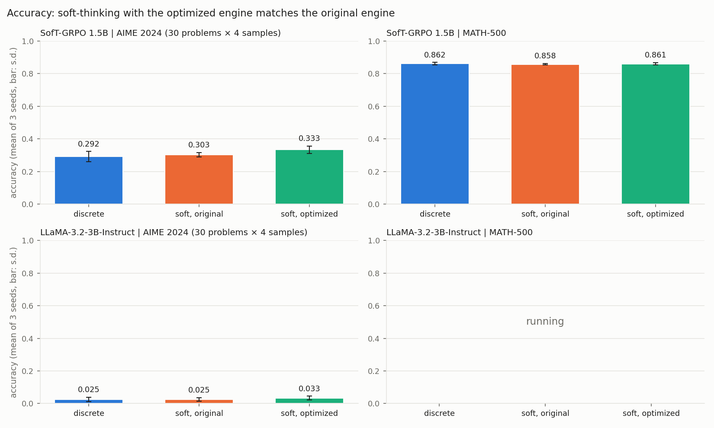
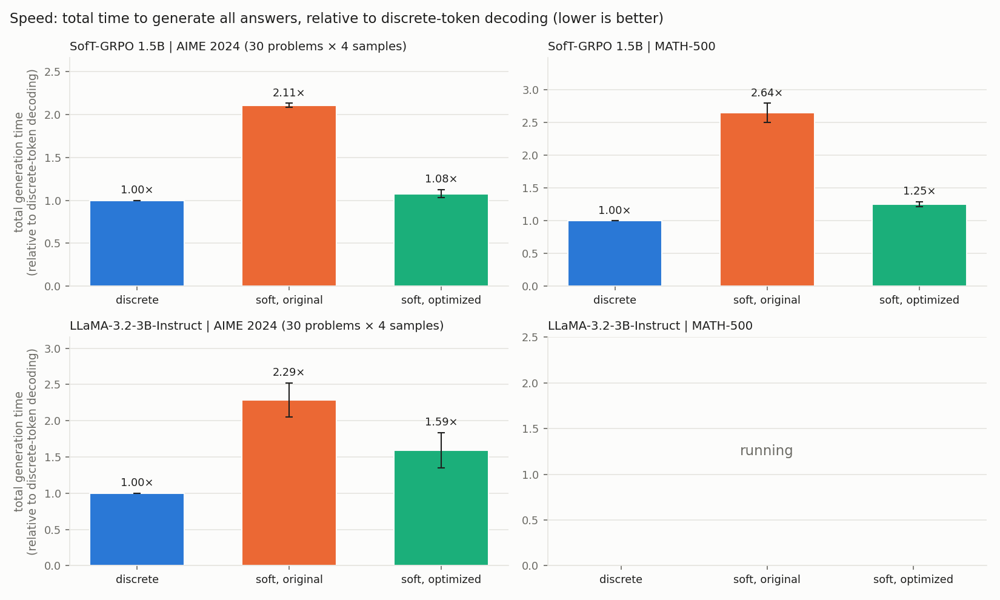

# Optimized soft-thinking engine: accuracy, speed and outputs

Two models × two benchmarks, with the paper's decoding (τ=1.0, top-k 5, top-p 0.95, τ_g=0.1) and the paper's 32,768-token generation budget. Each cell compares discrete-token decoding, soft-thinking with the original engine (as used in the paper), and soft-thinking with the optimized engine. Accuracy is the mean of 3 seeds (AIME 2024: 30 problems × 4 samples per seed; MATH-500: 500 problems per seed). Speed is the total wall-clock time to generate all answers of the benchmark on one H200 (mean of the same 3 seeds), relative to discrete-token decoding. Accuracy is graded with the paper's Table 1 grader (`matheval.py`, math-verify), the same for every run.

| model | benchmark | accuracy: discrete | accuracy: soft, original engine | accuracy: soft, optimized engine | total time: discrete / original / optimized | total time vs. discrete: original → optimized | outputs identical with optimizations off vs. on |
|---|---|---|---|---|---|---|---|
| SofT-GRPO 1.5B | AIME 2024 | 0.292 | 0.303 | 0.333 | 198 s / 417 s / 213 s | 2.11× → **1.08×** | **360 / 360** |
| SofT-GRPO 1.5B | MATH-500 | 0.862 | 0.858 | 0.861 | 162 s / 428 s / 203 s | 2.64× → **1.25×** | **1500 / 1500** |
| LLaMA-3.2-3B-Instruct | AIME 2024 | 0.025 | 0.025 | 0.033 | 149 s / 340 s / 239 s | 2.29× → **1.59×** | **360 / 360** |
| LLaMA-3.2-3B-Instruct | MATH-500 | running | running | running | running / running / running | running | running |

Total time also depends on how long the answers are, which varies with sampling. Mean response length in tokens (discrete / original / optimized): SofT-GRPO 1.5B, AIME 2024: 11,138 / 10,835 / 10,550; SofT-GRPO 1.5B, MATH-500: 3,588 / 3,556 / 3,546; LLaMA-3.2-3B-Instruct, AIME 2024: 1,222 / 1,612 / 2,089; LLaMA-3.2-3B-Instruct, MATH-500: running / running / running.

## Output examples

For the same batch, the optimized engine generates exactly the same text as with every optimization switched off. One example per cell (seed 0, first sample, first 400 characters):

**SofT-GRPO 1.5B, AIME 2024** (identical; final answer: `73`, reference: `73`)

| optimizations off | optimizations on |
|---|---|
| Okay, so I have this problem about residents in Aimeville and which things they own. There are four things: diamond rings, set of golf clubs, garden spades, and candy hearts. The total number of residents is 900, and each resident owns at least one of these things, I assume. Wait, actually, the problem says each owns a bag of candy hearts, which suggests that every resident owns at least one. So,  | Okay, so I have this problem about residents in Aimeville and which things they own. There are four things: diamond rings, set of golf clubs, garden spades, and candy hearts. The total number of residents is 900, and each resident owns at least one of these things, I assume. Wait, actually, the problem says each owns a bag of candy hearts, which suggests that every resident owns at least one. So,  |

**SofT-GRPO 1.5B, MATH-500** (identical; final answer: `\left(3, \frac{\pi}{2}\right)`, reference: `\left( 3, \frac{\pi}{2} \right)`)

| optimizations off | optimizations on |
|---|---|
| Okay, so I have to convert the rectangular coordinates (0,3) into polar coordinates. Hmm, I remember that polar coordinates are represented as (r, θ), where r is the distance from the origin to the point, and θ is the angle made with the positive x-axis.   First, I think I need to find r. I remember the formula for r is the square root of (x squared plus y squared). So, let's plug in the values. H | Okay, so I have to convert the rectangular coordinates (0,3) into polar coordinates. Hmm, I remember that polar coordinates are represented as (r, θ), where r is the distance from the origin to the point, and θ is the angle made with the positive x-axis.   First, I think I need to find r. I remember the formula for r is the square root of (x squared plus y squared). So, let's plug in the values. H |

**LLaMA-3.2-3B-Instruct, AIME 2024** (identical; final answer: `356`, reference: `73`)

| optimizations off | optimizations on |
|---|---|
| Let's denote by $A$, $B$, $C$ and $D$ the set of residents of Aimeville who own the diamond ring, the set of residents who own the golf clubs and the set of residents who own the garden spade. Using the Inclusion-Exclusion principle, we can write the following equation:  $\|A \cup B \cup C \cup D\| = \left(\|A\| + \|B\| + \|C\| + \|D\|\right) - \left(\left\|A \cap B\right\| + \left\|A \cap C\right\| + \left\|B \ | Let's denote by $A$, $B$, $C$ and $D$ the set of residents of Aimeville who own the diamond ring, the set of residents who own the golf clubs and the set of residents who own the garden spade. Using the Inclusion-Exclusion principle, we can write the following equation:  $\|A \cup B \cup C \cup D\| = \left(\|A\| + \|B\| + \|C\| + \|D\|\right) - \left(\left\|A \cap B\right\| + \left\|A \cap C\right\| + \left\|B \ |

---

All generated answers, per-run logs and the job scripts are in [`logs/final/check/`](logs/final/check). The figures and this page are built by `make_verify_figures.py`, and `check_correct.py` reruns any cell. Earlier fixed-length timing runs and md5 checks of the soft-token traces are in [`logs/`](logs).
