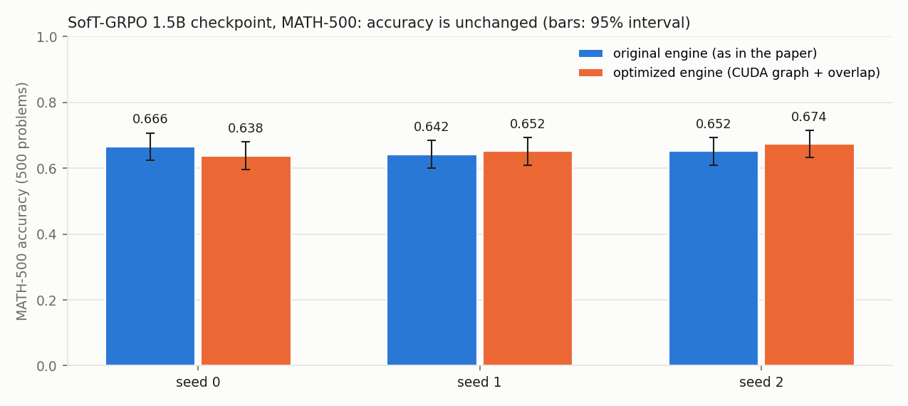
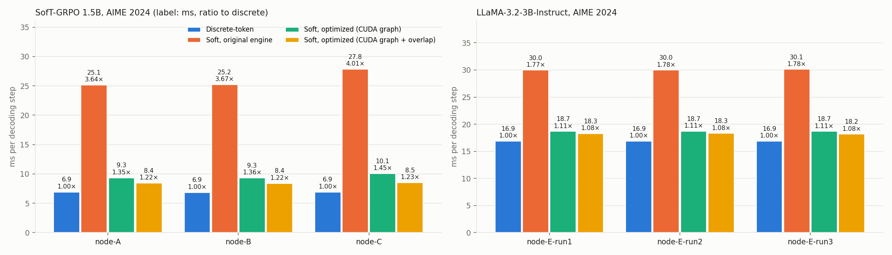
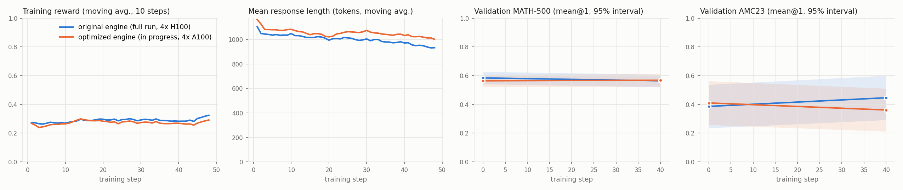

# Verifying the optimized soft-thinking engine

## At a glance

**1. Accuracy is unchanged.** The SofT-GRPO 1.5B checkpoint was run on all 500 MATH-500 problems with the original engine and with the optimized engine, with three seeds each. Mean accuracy is 0.653 (original) vs. 0.655 (optimized).



**2. The outputs are the same text.** For the same batch, the optimized engine generates exactly the same text as with every optimization switched off: **1,500 / 1,500 outputs are identical** (500 problems × 3 seeds). Problem 0, seed 0, first 500 characters:

| optimizations off | optimizations on |
|---|---|
| Okay, so I have to convert the rectangular coordinates (0,3) into polar coordinates. Hmm, I remember that polar coordinates are represented as (r, θ), where r is the distance from the origin to the point, and θ is the angle made with the positive x-axis. First, I think I need to find r. I remember the formula for r is the square root of (x squared plus y squared). So, let's plug in the values. Here, x is 0 and y is 3. So, r would be sqrt((0)^2 + (3)^2). Calculating that, it would be sqrt(0 + 9 | Okay, so I have to convert the rectangular coordinates (0,3) into polar coordinates. Hmm, I remember that polar coordinates are represented as (r, θ), where r is the distance from the origin to the point, and θ is the angle made with the positive x-axis. First, I think I need to find r. I remember the formula for r is the square root of (x squared plus y squared). So, let's plug in the values. Here, x is 0 and y is 3. So, r would be sqrt((0)^2 + (3)^2). Calculating that, it would be sqrt(0 + 9 |

**3. It is much faster.** Time per decoding step on AIME 2024 is shown relative to discrete-token decoding on the same node:
- SofT-GRPO 1.5B, three H200 nodes: original engine 3.64–4.01×, optimized engine **1.22–1.23×**.
- LLaMA-3.2-3B-Instruct, three runs: original engine 1.77–1.78×, optimized engine **1.08×**.
- On MATH-500 with natural lengths, generating all 500 answers takes 45–52 s instead of 107–122 s.



Every number on this page comes from a raw log in this folder; the figures and tables are built by `make_verify_figures.py`. Local paths and host names in the logs are replaced (`/path/to`, `node-A` …).

## 1. Accuracy and outputs (MATH-500)

Setup:
- Script: `check_correct.py`.
- Data: all 500 MATH-500 problems, one sample each.
- Decoding B (τ=1.0, top-k 5, τ_g=0.1), up to 3072 new tokens.
- Model: SofT-GRPO 1.5B checkpoint, one H200 per seed.
- Grading: exact match of the last `\boxed{}` after removing formatting that does not change the value. The same grader is used for both engines.

Outputs: `logs/final/outputs/seed*/{orig,opt,hold_off,hold_on}.jsonl.gz`. Logs: `logs/final/run_case18_seed*.log`.

Runs per seed:
- `orig`: the original engine as used in the paper.
- `opt`: the optimized engine with CUDA graph + overlap.
- `hold_off` / `hold_on`: optimizations off / on, same CUDA graph + overlap setting, all requests queued before the first prefill so that the batch composition is the same.

| seed | accuracy, original engine | accuracy, optimized engine | wall-clock for 500 answers | identical outputs, optimizations off vs on |
|---|---|---|---|---|
| 0 | 0.666 | 0.638 | 107 s → 45 s (2.4×) | 500 / 500 |
| 1 | 0.642 | 0.652 | 122 s → 52 s (2.3×) | 500 / 500 |
| 2 | 0.652 | 0.674 | 111 s → 45 s (2.5×) | 500 / 500 |
| mean | 0.653 | 0.655 | | |

Final answers on the first 10 problems (seed 0). `None` means that no `\boxed{}` answer was produced within 3072 tokens.

| # | reference | original engine | optimized engine |
|---|---|---|---|
| 0 | `\left( 3, \frac{\pi}{2} \right)` | ✓ `(3, \frac{\pi}{2})` | ✓ `(3, \frac{\pi}{2})` |
| 1 | `p - q` | ✗ `None` | ✓ `p - q` |
| 2 | `\frac{14}{3}` | ✓ `\dfrac{14}{3}` | ✓ `\dfrac{14}{3}` |
| 3 | `9` | ✓ `9` | ✓ `9` |
| 4 | `\text{Evelyn}` | ✓ `Evelyn` | ✗ `None` |
| 5 | `42` | ✓ `42` | ✓ `42` |
| 6 | `27` | ✓ `27` | ✓ `27` |
| 7 | `90^\circ` | ✓ `90` | ✓ `90` |
| 8 | `3\sqrt{13}` | ✓ `3\sqrt{13}` | ✓ `3\sqrt{13}` |
| 9 | `4` | ✗ `None` | ✗ `None` |

The original and optimized engines draw different random samples (`orig` vs `opt`), so individual answers differ while the accuracy is the same. With the same batch and seed (`hold_off` vs `hold_on`), every output is identical.

## 2. Identical outputs: md5 checks

With `--hold_prefill 1`, all requests are queued before the first prefill, so the batch composition is the same. The md5 values cover all 240 generated texts (`text_md5`) and all soft-token traces, i.e. top-k probabilities, indices and Gumbel values (`topk_md5`). Setup: AIME 2024, 240 sequences × 2048 tokens.

| Engine configuration | Optimizations off | Optimizations on | text_md5 | topk_md5 | File |
|---|---|---|---|---|---|
| no CUDA graph, no overlap | `X_unopt_nocg` | `X_final_nocg` | e579ff84… | d098609d… | `logs/results10.jsonl` |
| CUDA graph | `X_unopt_cg` | `X_final_cg` | 6117e6c8… | 44fbc4d3… | `logs/results10.jsonl` |
| CUDA graph + overlap | `X_unopt_cg_ov` | `X_final_cg_ov` | 7ff1ec0e… | 10a669dd… | `logs/final/results14.jsonl` |

Per-step bitwise checks:
- Exact compact sampler vs full-vocabulary path: 413,795 rows, 0 mismatches (`[ST-CHECK-EXACT]` in `logs/run_case10.log`).
- Overlap-scheduled inputs vs non-overlap rule: 476,904 rows, 0 mismatches (`[ST-CHECK-OV]` in `logs/final/run_case14.log`).

## 3. Time per decoding step (AIME 2024)

Setup: 240 sequences × 2048 tokens, decoding B, one H200. Each node or run measures all four configurations in one job. Ratios are relative to discrete-token decoding (CUDA graph + overlap) in the same job.

SofT-GRPO 1.5B checkpoint (`logs/final/results15_node-*.jsonl`):

| node | discrete | original engine | optimized (CUDA graph) | optimized (CUDA graph + overlap) |
|---|---|---|---|---|
| node-A | 6.91 ms | 25.13 ms (3.64×) | 9.33 ms (1.35×) | **8.45 ms (1.22×)** |
| node-B | 6.86 ms | 25.21 ms (3.67×) | 9.31 ms (1.36×) | **8.40 ms (1.22×)** |
| node-C | 6.93 ms | 27.81 ms (4.01×) | 10.06 ms (1.45×) | **8.50 ms (1.23×)** |

LLaMA-3.2-3B-Instruct, three runs on one node (`logs/final/results17_llama_node-E-run*.jsonl`):

| run | discrete | original engine | optimized (CUDA graph) | optimized (CUDA graph + overlap) |
|---|---|---|---|---|
| 1 | 16.89 ms | 29.96 ms (1.77×) | 18.69 ms (1.11×) | **18.27 ms (1.08×)** |
| 2 | 16.88 ms | 29.97 ms (1.78×) | 18.73 ms (1.11×) | **18.31 ms (1.08×)** |
| 3 | 16.90 ms | 30.11 ms (1.78×) | 18.67 ms (1.11×) | **18.18 ms (1.08×)** |

Decoding A (τ=0.6, top-k 30, τ_g=0.5), SofT-GRPO 1.5B, node-C (`logs/final/results14.jsonl`): original engine 4.78×, optimized 2.04×.

The original engine varies more across nodes because its per-request Python work is CPU-bound. The larger 3B model spends more time in the forward pass, so the fixed soft-token overhead is a smaller fraction of each step.

## 4. SofT-GRPO training with the optimized engine (in progress)

Setup:
- Qwen2.5-Math-1.5B, the hyperparameters of the paper's runs (`training/run_softgrpo_qwen_math_1p5b.sh`)
- 4× A100
- the rollout uses CUDA graph

**Step-1 rollouts are identical inside verl training.**
- Fixed engine seed; every request is held until all are queued.
- The original engine (every optimization off) is compared with the optimized engine (every optimization on, same CUDA graph / overlap setting).
- Columns: md5 of the 128 rollouts per worker for tokens, soft-token traces and log-probabilities.
- Files: `training/logs/step1_md5_original_engine.txt`, `training/logs/step1_md5_optimized_engine.txt`.

| Rollout worker | tokens | trace | log-prob | identical |
|---|---|---|---|---|
| 0 | 5033f907… | be13c32b… | d2e7122b… | yes |
| 1 | 9cfdc257… | 79a977a9… | 6e8d34dd… | yes |
| 2 | 915de67b… | c1614da2… | d0f2e7e3… | yes |
| 3 | 9a4170a0… | 913a54b0… | 4073ea66… | yes |

**Rollout time per training step, same 4× A100 server:**
- Original engine: 53.3 s (steps 1–3, `training/logs/original_engine_hold.log`).
- Optimized engine: 28.0 s (`training/logs/optimized_engine_cuda_graph_run.partial.log`).
- The rollout is 1.9× faster. The actor update (~59 s per step) does not involve the engine and is unchanged.

**Training curves vs. the paper's original-engine run** (4× H100, `training/logs/original_engine_full_run.log`, 629 steps):
- Validation scores carry 95% binomial intervals over the benchmark's problems.
- At step 0, both runs evaluate the same untrained model, so the gap there is pure evaluation noise.
- The figure is updated as training continues (`training/compare_training.py`).



## 5. Reproduce

```bash
export PYTHONPATH=../../sglang_soft_thinking_pkg/python
python check_correct.py --model <checkpoint> --data ../../datasets/math500.json --num 500 --cuda_graph 1 --overlap 1  # accuracy
bash run_overhead.sh <checkpoint>                                   # timing and md5 exactness
MODEL_PATH=<Qwen2.5-Math-1.5B> bash training/run_softgrpo_qwen_math_1p5b.sh orig   1 1   # step-1 md5, original
MODEL_PATH=<Qwen2.5-Math-1.5B> bash training/run_softgrpo_qwen_math_1p5b.sh optraw 1 1   # step-1 md5, optimized
python make_verify_figures.py                                       # figures and tables of this page
```
