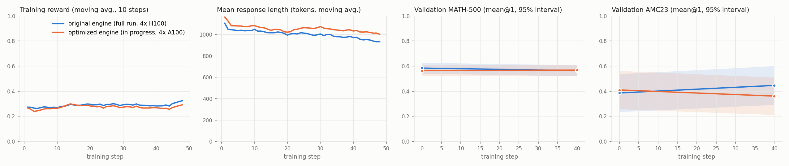
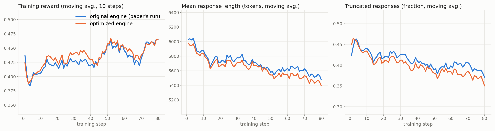

# SofT-GRPO training with the optimized engine

This folder reproduces SofT-GRPO training with the original and the optimized soft-thinking engine on two models, Qwen2.5-Math-1.5B and DeepSeek-R1-Distill-Qwen-1.5B. It checks two things: that the optimized engine leaves training unchanged, and that it trains faster.

## Qwen2.5-Math-1.5B

Hyperparameters follow the paper's Qwen2.5-Math-1.5B runs:
- deepscaler training data
- 64 prompts × 8 rollouts per step
- up to 3072 response tokens
- τ=1.0, top-k 5, τ_g=0.1

Both runs use the same 4×A100 server and the same configuration; only the engine differs. The original engine runs as in the paper, without CUDA graph. The optimized engine runs with CUDA graph (`optcg` mode below).

**Identical start.** In the first training step, all 512 rollouts are bit-identical between the two engines: the generated tokens, the soft-token traces and the rollout log-probabilities. For this check both engines run without CUDA graph, with a fixed seed, and all requests are queued before the first prefill (see "Exactness inside training" below). Checksums per rollout worker: [`logs/step1_md5_original_engine.txt`](logs/step1_md5_original_engine.txt), [`logs/step1_md5_optimized_engine.txt`](logs/step1_md5_optimized_engine.txt).

**Same training, faster rollout.** Steps 1–100:

|mean over steps 1–100|original engine|optimized engine|
|---|---|---|
|training reward|0.297|0.290|
|response length (tokens)|995|1000|
|truncated responses|8.2%|8.2%|
|rollout time per step (s)|52.3|**27.6**|
|actor update per step (s)|58.0|58.4|
|full training step (s)|135.0|**106.5**|



**Compared with discrete-token GRPO.** On the same server, discrete-token GRPO (no soft-thinking; temperature 1.0, no top-k, top-p 1.0; CUDA graph + overlap) was run for 30 steps with the same configuration (`discrete` mode below). Steps 1–30 of all three runs:

|mean over steps 1–30|discrete-token GRPO|SofT-GRPO, original engine|SofT-GRPO, optimized engine|
|---|---|---|---|
|response length (tokens)|1046|1063|1060|
|rollout time per step (s)|21.8|53.1 (2.43×)|**28.0 (1.28×)**|
|full training step (s)|98.3|130.5 (1.33×)|**105.8 (1.08×)**|

With the optimized engine, a SofT-GRPO training step takes 1.08× the time of a discrete-token GRPO step in this setting. The actor update, the log-probability passes and the reference model take the same time in all three runs (about 58 s, 10.5 s and 8 s per step).


Logs:
- [`logs/same_machine_original_engine.log`](logs/same_machine_original_engine.log): original engine, steps 1–100
- [`logs/same_machine_optimized_engine.log`](logs/same_machine_optimized_engine.log): optimized engine, steps 1–100
- [`logs/same_machine_discrete_grpo.log`](logs/same_machine_discrete_grpo.log): discrete-token GRPO, steps 1–30
- [`logs/original_engine_hold.log`](logs/original_engine_hold.log), [`logs/optimized_engine_hold.log`](logs/optimized_engine_hold.log): the step-1 exactness runs

Rebuild the figure and the tables with:

```bash
python compare_training.py --a logs/same_machine_original_engine.log --b logs/same_machine_optimized_engine.log
```

## DeepSeek-R1-Distill-Qwen-1.5B

Configuration of the paper's script `SofT-GRPO-deepscaler-8k.sh`:
- deepscaler training data
- 64 prompts × 8 rollouts per step on 8 GPUs
- up to 8192 response tokens
- τ=1.0, top-k 5, top-p 0.95, τ_g=0.1, KL coefficient 0.002, CPU offload

**Same training.** The paper's run with the original engine and a new run with the optimized engine (`opt` mode below), both on 8×H200 with this configuration. Steps 1–80:

|mean over steps 1–80|original engine (paper's run)|optimized engine|
|---|---|---|
|training reward|0.433|0.440|
|response length (tokens)|5675|5612|
|truncated responses|40.7%|39.4%|



The curve run uses CUDA graph + overlap scheduling (`opt`), and its step times are not used here: with overlap scheduling, the engine is slow to return the per-token log-probabilities that training requests. Step times are measured with CUDA graph only (`optcg`, as in the Qwen2.5-Math-1.5B run).

**Faster training step.** Per-step times on 4×H200 with half the batch (32 prompts × 8, mini-batch 16), so that every GPU does the same work as in the 8-GPU configuration. The three runs use the same node, one after another. Mean over steps 1–3:

|mean over steps 1–3|discrete-token GRPO|SofT-GRPO, original engine|SofT-GRPO, optimized engine|
|---|---|---|---|
|response length (tokens)|6320|6183|6212|
|rollout time per step (s)|44.6|120.4 (2.70×)|**63.7 (1.43×)**|
|full training step (s)|86.9|162.3 (1.87×)|**106.6 (1.23×)**|

With the optimized engine, a SofT-GRPO training step takes 1.23× the time of a discrete-token GRPO step in this setting (1.87× with the original engine). The actor update, the log-probability passes and the reference model take the same time in all three runs (about 23 s, 10 s and 9 s per step).

Logs:
- [`logs/deepseek_original_engine_paper_run.csv`](logs/deepseek_original_engine_paper_run.csv): the paper's run, all 629 steps, exported from its tensorboard file
- [`logs/deepseek_optimized_engine.log`](logs/deepseek_optimized_engine.log): optimized engine, steps 1–81 (the comparison above uses steps 1–80)
- [`logs/deepseek_steptime_discrete_grpo.log`](logs/deepseek_steptime_discrete_grpo.log), [`logs/deepseek_steptime_original_engine.log`](logs/deepseek_steptime_original_engine.log), [`logs/deepseek_steptime_optimized_engine.log`](logs/deepseek_steptime_optimized_engine.log): step times, steps 1–3

Rebuild the figure and the table with:

```bash
python compare_training.py --a logs/deepseek_original_engine_paper_run.csv --a_name "original engine (paper's run)" \
                           --b logs/deepseek_optimized_engine.log --panels train --max_step 80 --out compare_training_deepseek.png
```

## Run

```bash
pip install -r ../../../../requirements.txt   # same environment as the rest of the repo
export MODEL_PATH=/path/to/Qwen2.5-Math-1.5B
bash run_softgrpo_qwen_math_1p5b.sh orig  10      # original engine (every optimization off), 10 steps
bash run_softgrpo_qwen_math_1p5b.sh optcg 1000    # optimized engine, CUDA graph (the run above)
bash run_softgrpo_qwen_math_1p5b.sh opt   1000    # optimized engine, CUDA graph + overlap
bash run_softgrpo_qwen_math_1p5b.sh discrete 30   # discrete-token GRPO, timing reference

export MODEL_PATH=/path/to/DeepSeek-R1-Distill-Qwen-1.5B
bash run_softgrpo_deepseek_1p5b.sh opt 1000                       # optimized engine, 8 GPUs (the curve run above)
NUM_GPUS=4 VAL=False bash run_softgrpo_deepseek_1p5b.sh optcg 3     # step times: optimized engine
NUM_GPUS=4 VAL=False bash run_softgrpo_deepseek_1p5b.sh orig 3      # step times: original engine
NUM_GPUS=4 VAL=False bash run_softgrpo_deepseek_1p5b.sh discrete 3  # step times: discrete-token GRPO
```

Per-step times are in the `timing_s/gen` (rollout) and `timing_s/step` fields of the console log.

`OFFLOAD=True` reproduces the CPU offload of the paper's runs. The default (`False`) keeps parameters and optimizer states on the GPU, which is faster for a 1.5B model. Offloading only changes where tensors are stored, not the algorithm.

## Exactness inside training

With `HOLD=1`, three things change: the engine seed is fixed, all requests of a rollout are queued before the first prefill (so the batch composition does not depend on arrival times), and the md5 of every rollout is printed:

```bash
bash run_softgrpo_qwen_math_1p5b.sh orig   1 1
bash run_softgrpo_qwen_math_1p5b.sh optraw 1 1
```

`optraw` turns every optimization on but, like `orig`, runs without CUDA graph and without overlap. CUDA graph and overlap scheduling are standard SGLang features that change floating-point summation order, so they are compared separately in `../logs`.

For each rollout worker (`rank`), the `[ST-ROLLOUT-MD5]` line of step 1 must be identical in the two runs. The line covers:
- the generated tokens (`tokens`)
- the soft-token traces: top-k indices and Gumbel values (`trace`)
- the rollout log-probabilities (`logprob`)

Ray writes the full per-worker output to `/tmp/ray/session_latest/logs/worker-*.out`.

## Compare two training runs

```bash
python compare_training.py --a original.log --a_name "original engine" \
                           --b optimized.log --b_name "optimized engine" --out compare.png
```

The script plots the training reward, the mean response length, the rollout time per step, and the MATH-500 validation score of both runs (`--panels train`: the training reward, the mean response length and the fraction of truncated responses). It also prints all training and validation numbers (MATH-500, AMC with 83 problems, AIME24) and the rollout checksums as markdown. A run can also be given as a CSV file with a `step` column and one column per metric.
